# ATTENDKA — Wireframes & Flows

> **Last synced with codebase:** `ATTENDKA-main.zip` snapshot, 2026-11-06 · sources: `Frontend/public/*.html`, `Frontend/js/*.js`, `Backend/src/routes/*`
> Companion docs: [[System Documentation]] · [[Implementation Tracker]] · [[API Contracts/00-conventions]]
> Wireframes are **schematic** (structure and content, not pixel layout). Page titles, nav labels, and status values are taken from the UI; button captions inside panels are approximate.

## Contents

1. [[#Route Map]]
2. [[#Role Visibility Matrix]]
3. [[#Flows]] — sign-in, registration, card tap, event lifecycle, reader setup, manual correction, reporting, masterlist→team, live display, card login
4. [[#Wireframes]] — 13 screens plus the reader LCD

---

## Route Map

The product is **five HTML pages**. Everything after sign-in happens inside one single-page dashboard (`app.html`) where the sidebar swaps "pages" in place; the URL does not change.

### Browser pages

| Route | File | Access | Purpose | Redirects |
|-------|------|--------|---------|-----------|
| `/` | `index.html` | Public | Sign in (lamp-pull animation reveals the form) | Success → `app.html` |
| `/register.html` | `register.html` | Public | Student self-registration | Success → `app.html` |
| `/app.html` | `app.html` | Any signed-in role | Dashboard shell | No token or `GET /auth/me` fails → `index.html` |
| `/attendance-display.html` | `attendance-display.html` | Admin / teacher token | Live check-in kiosk | "Back to dashboard" → `app.html` |
| `/card-login.html#t=<token>` | `card-login.html` | Public | Card-tap sign-in landing — ⛔ **backend route not mounted** | Success → `app.html`; failure shows "Card not recognized" |

### Pages inside `app.html` (sidebar)

| Sidebar item | Page id | Visible to | Main API calls (see [[API Contracts/00-conventions]]) |
|--------------|---------|------------|------------------------------------------------------------|
| Dashboard | `dashboard` | All (different content for students) | `GET /attendance/overview`, `GET /attendance/recent?limit=3`, `GET /events`; student: `GET /students/me/points`, `GET /students/me/events` |
| Events | `event-management` | Admin | `GET/POST /events`, `PATCH/DELETE /events/:id`, `GET /departments` |
| RFID devices | `rfid-management` | Admin | `GET/POST/PATCH/DELETE /admin/readers…`, `GET/POST/PATCH /admin/cards…`, `GET/PUT /admin/rfid/event-assignments`, `GET /events?date=` |
| Accounts | `accounts-management` | Admin | `GET/POST /admin/users`, `POST /admin/departments`, `PATCH /admin/teachers/:id/department` |
| Student photos | `student-photos` | Admin | `GET/PUT /admin/students/:userId/photo` |
| Student directory | `student-directory` | Admin, teacher | `GET /students`, `PUT /admin/students/:id` (admin) |
| Masterlists | `masterlists` | Admin | `GET /masterlists`, `POST /admin/masterlists`, `PATCH /admin/masterlists/:id`, masterlist student add/remove, candidates, `GET /teams`, `POST /admin/teams`, `…/members/bulk`, `…/advisers` |
| Team adviser | `team-adviser` | Teacher | `GET /teams/advising`, `GET /teams/:id/attendance` |
| Course Attendance | `attendance` | Admin, teacher | `GET /attendance/report` (month + event), `PUT /admin/events/:e/students/:s/attendance` |
| School calendar | `calendar` | All | Staff: `GET /events`; student: `GET /students/me/events`; admin extras: `PATCH /events/:id` |
| Upcoming events | `student-events` | Student | `GET /students/me/events` |
| Reports | `reports` | Admin, teacher | `GET /attendance/report` + CSV download |
| Settings | `settings` | All | `PATCH /auth/me` (staff), `POST /auth/password` |
| Live Check-in (link) | — | Admin, teacher | Opens `attendance-display.html` |
| Sign out (button) | — | All | Clears `localStorage`, → `index.html` |

### Functions with API but no screen

| API | Missing UI |
|-----|-----------|
| `PATCH /admin/users/:id/active` | No Deactivate/Reactivate button |
| `GET /admin/attendance/logs` | No scan-log viewer |
| `POST /admin/points` | No manual points form |
| `PUT /students/me/events/:id/checklist` | Removed from UI (compat only) |
| `GET /admin/overview` | Superseded |

---

## Role Visibility Matrix

| Screen | Student | Teacher | Admin | Legacy team leader |
|--------|:------:|:-------:|:-----:|:------------------:|
| Dashboard (stats, recent) | — | ✔ scoped | ✔ | — |
| Dashboard (my points/events) | ✔ | — | — | ✔ |
| Events | — | — | ✔ | — |
| RFID devices | — | — | ✔ | — |
| Accounts | — | — | ✔ | — |
| Student photos | — | — | ✔ | — |
| Student directory | — | ✔ scoped | ✔ | — |
| Masterlists | — | — | ✔ | — |
| Team adviser | — | ✔ | — | — |
| Course Attendance | — | ✔ scoped, no time edits | ✔ | — |
| School calendar | ✔ read-only | ✔ read-only | ✔ + controls | ✔ read-only |
| Upcoming events | ✔ | — | — | ✔ |
| Reports | — | ✔ scoped | ✔ | — |
| Live display | — | ✔ scoped | ✔ + reset | — |
| Settings | ✔ password only | ✔ | ✔ | ✔ password only |

The UI hides what a role cannot use, but the **API enforces** the rules (see [[System Documentation#Cross-Cutting Rules]]).

---

## Flows

### Flow 1 — Sign in and role routing

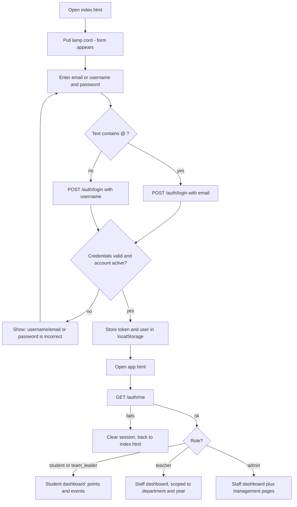

Error states: invalid credentials (`401`), network failure ("Cannot reach the ATTENDKA API…"), the free-tier host cold start (card-login page warns "this can take up to a minute").

### Flow 2 — Student registration

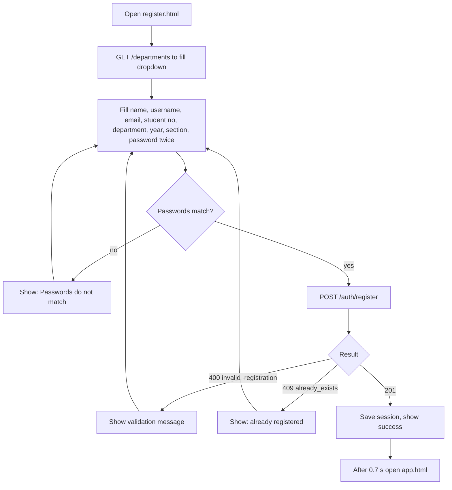

### Flow 3 — Card tap

The core product flow. Business rules: [[System Documentation#6. RFID Scan Processing]]; responses: [[API Contracts/04-scan-processing]].

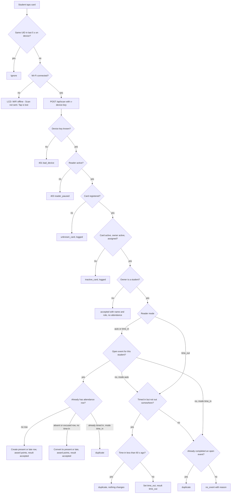

Device feedback: `accepted`, `duplicate`, `time_out` → one long beep; everything else → five short beeps. LCD text per result is listed under [[#Wireframe 14 — Reader LCD and buzzer]].

### Flow 4 — Event lifecycle and the attendance gate

Two independent controls: **status** (what happened to the event) and **attendance switch** (may students time in right now).

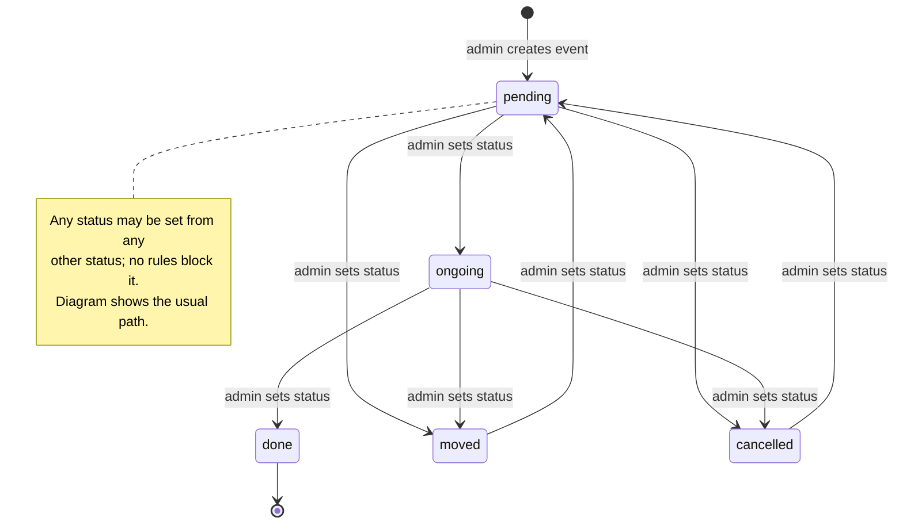

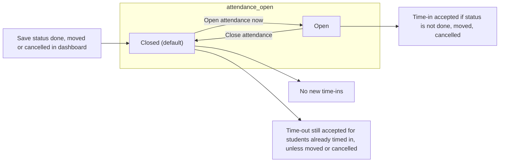

### Flow 5 — Reader setup and event assignment (admin)

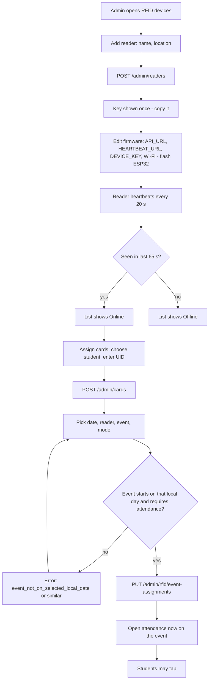

### Flow 6 — Manual attendance correction

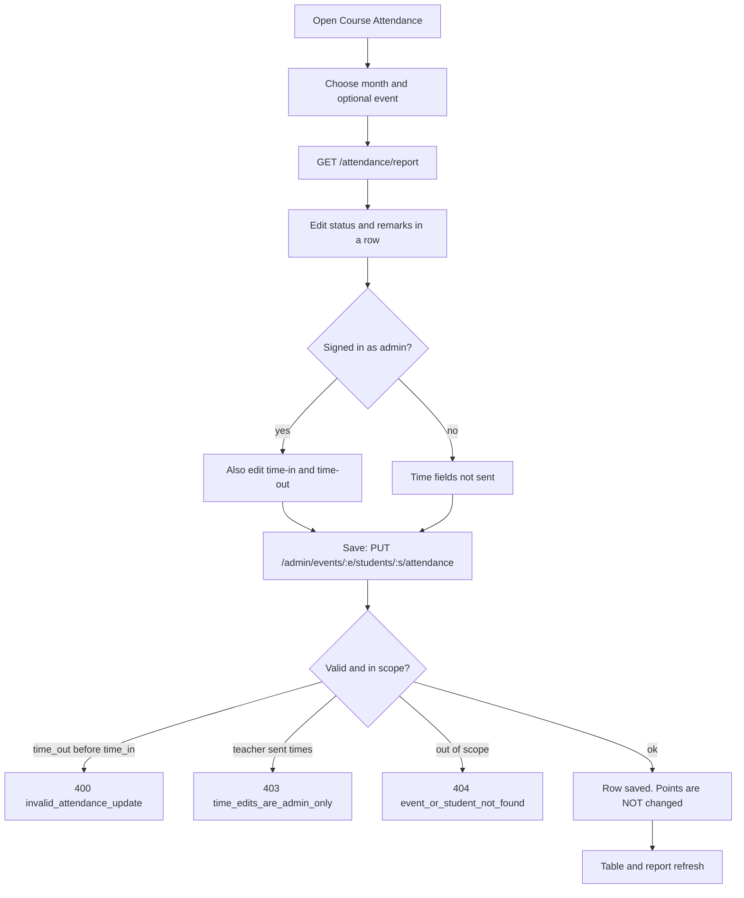

### Flow 7 — Reports and CSV

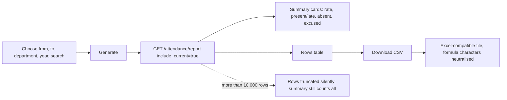

### Flow 8 — Masterlist → team → adviser

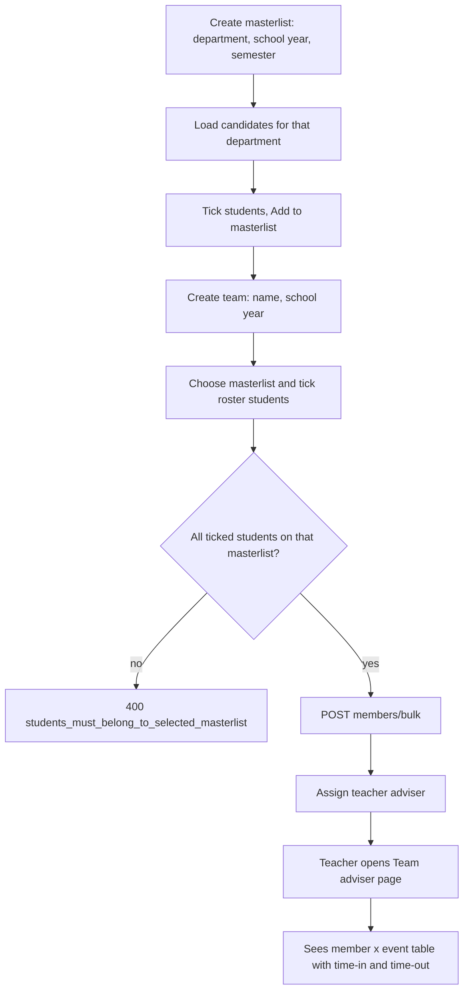

### Flow 9 — Live display and reset

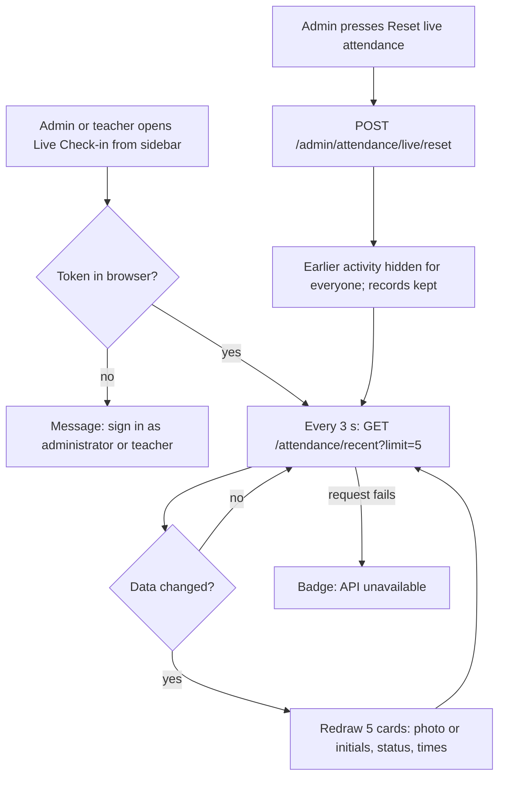

### Flow 10 — Card-tap web login (⛔ not live)

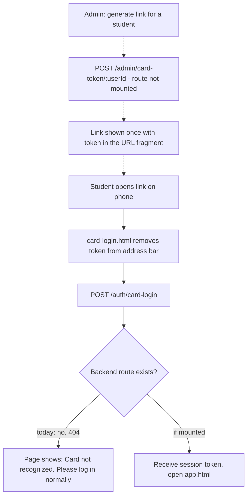

---

## Wireframes

Notation: `[ Button ]` button · `( ) / (•)` radio · `[x]` checkbox · `[▼]` dropdown · `____` text input · `▒` photo/avatar · `⚑` status badge.

### Wireframe 1 — Sign in (`index.html`)

```
┌───────────────────────────────────────────────────────────────┐
│                          │ lamp                                │
│                       ┌──┴──┐        (page is dark until the   │
│                       │shade│         cord is pulled; beam      │
│                       └─────┘         lights the card)          │
│                          ◯  ← pull cord                         │
│   ┌─────────────────────────────────────────────┐              │
│   │ [logo]  ATTENDKA?                           │              │
│   │         Attendance Management               │              │
│   │                                             │              │
│   │ Welcome back                                │              │
│   │ Sign in to your account                     │              │
│   │ ⚠ error message appears here                │              │
│   │                                             │              │
│   │ Email or Username                           │              │
│   │ [ admin_____________________________ ]      │              │
│   │ Password                                    │              │
│   │ [ ••••••••__________________________ ]      │              │
│   │ [              Sign In               ]      │              │
│   │                                             │              │
│   │ Don't have an account? Register             │              │
│   └─────────────────────────────────────────────┘              │
└───────────────────────────────────────────────────────────────┘
```

### Wireframe 2 — Student registration (`register.html`)

```
┌──────────────────────────────────────────────┐
│ [logo] PTCI  Attendance Management           │
│ Create account                               │
│ Create a student account. Teacher/admin      │
│ accounts are created by an administrator.    │
│ ░ message (error / success) ░                │
│ First Name [________]  Last Name [________]  │
│ Username   [______________________________]  │
│ Email      [______________________________]  │
│ Student number [__________] (max 30)         │
│ Department [▼ Select a department        ]   │
│ Year level [▼ 1st…5th ]  Section [_____]     │
│ Password   [••••••••] (min 8)                │
│ Confirm    [••••••••]                        │
│ [        Create Student Account        ]     │
│ Already have an account? Sign in             │
└──────────────────────────────────────────────┘
```

### Wireframe 3 — Dashboard shell (all roles)

```
┌────────┬───────────────────────────────────────────────────────┐
│ ATTENDKA?        [ 🔍 Search students / attendance ]  ▒ Name ▾ │
│ MENU   ├───────────────────────────────────────────────────────┤
│ ▣ Dashboard │  <page content — see wireframes 4–13>            │
│ ▣ Events*   │                                                  │
│ ▣ RFID dev* │  * = admin only; items hidden per role           │
│ ▣ Accounts* │                                                  │
│ ▣ Photos*   │                                                  │
│ ▣ Directory │                                                  │
│ ▣ Masterlists*                                                 │
│ ▣ Team adviser (teacher)                                       │
│ ▣ Course Attendance                                            │
│ ▣ School calendar                                              │
│ ▣ Upcoming events (student)                                    │
│ ▣ Reports   │                                                  │
│ ▣ Settings  │                                                  │
│ ▣ Live Check-in ↗                                              │
│ ⏻ Sign out  │                                                  │
└────────┴───────────────────────────────────────────────────────┘
```

### Wireframe 4 — Staff dashboard (admin / teacher)

```
Dashboard                                   [ Reset live attendance ]*  
┌──────────────┬──────────────┬──────────────┬──────────────┐
│ Students     │ Attendance   │ Present/Late │ Events live  │
│   320        │ today  210   │  190 / 20    │      2       │
└──────────────┴──────────────┴──────────────┴──────────────┘
┌─ Check-in activity (last 30 days) ──────────────────────────┐
│ ▢▢▣▣▢▣▣▣▢▢▣▣▣▣ ▢▣▣▣▣▣▢▢▣▣▣▣▣▣▣   (cell shade = check-ins)  │
└─────────────────────────────────────────────────────────────┘
┌─ Recent check-ins ───────────────┐ ┌─ Upcoming events ──────┐
│ ▒ Alex Student · 2026-0001       │ │ Foundation Day  Nov 10 │
│   Foundation Day      Timed in   │ │ Gym · pending          │
│ ▒ Bea Cruz · 2026-0007  Timed out│ │ Seminar       Nov 12   │
└──────────────────────────────────┘ └────────────────────────┘
┌─ Attendance rate ──────────────────────────────────────────┐
│ Overall 90.5%   Absent 80   Excused 20                      │
└─────────────────────────────────────────────────────────────┘
* admin only. Teachers see only their department/year.
```

### Wireframe 5 — Student dashboard

```
My student dashboard
Welcome, Alex Student
┌─ My points ─────────┐  Student no. 2026-0001
│        25           │
└─────────────────────┘
┌─ Contribution graph ───────────────  25 points this year ──┐
│ ▢▢▢▣▢▢▢▢▣▣▢▢▢▢▢▢▢▢▣▢▢▢▢▢▢▢▢▢▢▢▢▢▢▢▢▢▢▢▢▢▢▢▢▢▣▢▢▢▢▢▢▢▢▢▢▢ │
└─────────────────────────────────────────────────────────────┘
┌─ Events for my department ──────────────────────────────────┐
│ ┌────────────────────────────────────────────┐              │
│ │ Foundation Day   Nov 10 · 9:00 AM · Gym    │ ⚑ Upcoming   │
│ │ other · School-wide · pending              │              │
│ └────────────────────────────────────────────┘              │
│ ┌────────────────────────────────────────────┐              │
│ │ Orientation      Oct 02                    │ ⚑ Complete   │
│ └────────────────────────────────────────────┘              │
│ ⚑ values: Excused · Checked in · Complete · Moved ·         │
│   Not continuing · Done · School event · Absent · Upcoming  │
└─────────────────────────────────────────────────────────────┘
```

### Wireframe 6 — Events (admin)

```
Events
┌─ Create event ──────────────────────────────────────────────┐
│ Title [________________]  Type [▼ academic…other]           │
│ Venue [__________]  Department [▼ School-wide…]             │
│ Start [datetime]  End [datetime]                            │
│ [x] Requires attendance   Points [ 0 ]                      │
│ Description [__________________________]   [ Create event ] │
└─────────────────────────────────────────────────────────────┘
┌─ Calendar cards ────────────────────────────────────────────┐
│ ┌──────────────────────────────────────────────────────┐    │
│ │ Foundation Day                      ⚑ pending · CLOSED │  │
│ │ other · School-wide · Nov 10, 9:00 AM · Gym          │    │
│ │ [ Open attendance now ] [ Edit event ] [ Delete ]    │    │
│ │ ┌ editor (shown on Edit) ─────────────────────────┐  │    │
│ │ │ Title/Type/Venue/Description/Start/End          │  │    │
│ │ │ Status [▼ pending|ongoing|moved|done|cancelled] │  │    │
│ │ │ Status note [___________]        [ Save ]       │  │    │
│ │ └──────────────────────────────────────────────────┘ │    │
│ └──────────────────────────────────────────────────────┘    │
│ Button shows "Close attendance" while open; shows           │
│ "Attendance closed" (disabled) for done/moved/cancelled.    │
└─────────────────────────────────────────────────────────────┘
```

### Wireframe 7 — RFID devices (admin)

```
RFID devices
┌─ Readers (refreshes every 15 s) ────────────────────────────┐
│ ● Main Gate  Gate 1   Online   [ Pause ] [ Delete ]         │
│   Today: Foundation Day · ongoing                           │
│ ○ Hall A     Hall     Offline  [ Resume ] [ Delete ]        │
└─────────────────────────────────────────────────────────────┘
┌─ Add reader ────────────────────┐ ┌─ Assign card ──────────┐
│ Name [_________] Location [____]│ │ Student [▼ 2026-0001 …]│
│ [ Create reader ]               │ │ Card UID [__________]  │
│ Key: kF3…  (shown once)         │ │ [ Assign card ]        │
└─────────────────────────────────┘ └────────────────────────┘
┌─ Cards ─────────────────────────────────────────────────────┐
│ 04D4E5F6  Alex Student · active   [▼ student] [▼ status] [Save]│
└─────────────────────────────────────────────────────────────┘
┌─ Event assignment ──────────────────────────────────────────┐
│ Date [2026-11-10] Reader [▼] Event [▼ title · time · status]│
│ Mode [▼ auto | Manual time in | time out]   [ Assign ]      │
│ Existing: Main Gate → Foundation Day (auto)                 │
└─────────────────────────────────────────────────────────────┘
```

### Wireframe 8 — Accounts and departments (admin)

```
Accounts and departments
┌─ New department ───────────┐ ┌─ New staff account ─────────────┐
│ Code [____] Name [________]│ │ Role (•) Teacher ( ) Admin       │
│ [ Create department ]      │ │ Username/Password/Name/Email     │
└────────────────────────────┘ │ Teacher: Employee no, Department │
                               │          [▼], Year level [▼ all] │
                               │ Admin:   Position [______]       │
                               │ [ Create account ]               │
                               └──────────────────────────────────┘
┌─ Accounts ──────────────────────────────────────────────────┐
│ ▒ Tess Cruz   t.cruz · Teacher            #51               │
│ ▒ Alex Student student01 · Student        #42               │
│ (no activate/deactivate control in the UI)                  │
└─────────────────────────────────────────────────────────────┘
```

### Wireframe 9 — Student directory and photos

```
Student directory
Department [▼]  Year [▼]  Search [__________]
┌──────────────────────────────────────────────────────────────┐
│ Name              Student no.  Dept  Year  Section   Action   │
│ Student, Alex     2026-0001    BSIT  1     A        [ Edit ]* │
└──────────────────────────────────────────────────────────────┘
* admin only → opens "Edit student" panel (all fields required)

Student photos (admin)
Student [▼]   (•) Choose image  [ Browse… ]   [ Save photo ] [ Remove ]
┌──────────┐
│  preview │  Saved to database; appears on live display
└──────────┘
```

### Wireframe 10 — Course Attendance

```
Course Attendance
Month [2026-11]   Event [▼ all events]
┌──────────────────────────────────────────────────────────────────────┐
│ Student        Event      Status          Time in   Time out  Remarks │
│ Alex Student   Found.Day  [▼ present]     [admin]   [admin]   [____]  [Save] │
│ Bea Cruz       Found.Day  [▼ absent ]     —         —         [____]  [Save] │
└──────────────────────────────────────────────────────────────────────┘
Status options: present · late · absent · excused
[admin] = time fields shown only to administrators
Message line: "Attendance saved." / error text
```

### Wireframe 11 — Reports

```
Reports                              2026-11-01 to 2026-11-30
From [date] To [date]  Dept [▼]  Year [▼]  Search [_____]  [ Generate ] [ Download CSV ]
┌───────────────┬───────────────┬──────────────┬──────────────┐
│ Attendance %  │ Present / Late│ Absent       │ Excused      │
│    90.5%      │   480 / 60    │     80       │     20       │
└───────────────┴───────────────┴──────────────┴──────────────┘
┌──────────────────────────────────────────────────────────────────┐
│ Event  Date  Student  No.  Dept  Year  Status  In  Out  Remarks   │
│ …rows…  (max 10,000; truncated silently)                          │
└──────────────────────────────────────────────────────────────────┘
```

### Wireframe 12 — Masterlists and team adviser

```
Department masterlists (admin)
┌─ Create ───────────────────────────────────────────────────────┐
│ Department [▼] School year [2026-2027] Semester [▼ 1st|2nd|summer] [ Create ] │
└────────────────────────────────────────────────────────────────┘
┌─ Masterlists ──────────────┐ ┌─ Students of BSIT 2026-2027 1st ──────┐
│ ▸ BSIT 2026-2027 1st  (40) │ │ [x] Select all visible                │
│   BSED 2026-2027 1st  (28) │ │ Year 1 — [x] Student, Alex  2026-0001 │
└────────────────────────────┘ │ [ Save roster ] [ Remove selected ]   │
                               └────────────────────────────────────────┘
┌─ Teams ────────────────────────────────────────────────────────┐
│ Name [______] Year [2026-2027] [ Create team ]                  │
│ Team [▼] Masterlist [▼]  tick students  [ Add to team ]        │
│ Team [▼] Adviser [▼ teacher]            [ Assign adviser ]      │
└────────────────────────────────────────────────────────────────┘

Team adviser (teacher)
Team [▼ my teams]
┌──────────────────────────────────────────────────────────────┐
│ Event · date         Student     No.        In     Out  Status │
└──────────────────────────────────────────────────────────────┘
```

### Wireframe 13 — Live Check-in display (`attendance-display.html`)

```
┌────────────────────────────────────────────────────────────────────┐
│ [logo] ATTENDKA?  ● Live · refreshes every 3 seconds   10:42:07  [Full screen] │
│                                                                    │
│                      LIVE EVENT CHECK-IN                           │
│                   Welcome to Attendka?                             │
│   Tap your student card on the reader. Your check-in will appear.  │
│ ┌────────────────────────────────────────────────────────────┐     │
│ │ ┌──────┐  Alex Student                                     │     │
│ │ │  ▒▒  │  2026-0001 · BSIT                   Present        │     │
│ │ │ photo│  TIME IN 9:02 AM      TIME OUT —                   │     │
│ │ └──────┘  Foundation Day                                    │     │
│ ├────────────────────────────────────────────────────────────┤     │
│ │ (AS) Bea Cruz · 2026-0007 · BSED      Timed out            │     │
│ │ …up to 5 cards… (initials shown if no photo)               │     │
│ └────────────────────────────────────────────────────────────┘     │
│ Showing the latest 5 check-ins                         ● ○ ○ ○ ○    │
│ Attendance records update automatically.   Back to dashboard        │
└────────────────────────────────────────────────────────────────────┘
States: "Waiting for student check-ins…" · "Sign in required" · "API unavailable"
```

### Wireframe 14 — Reader LCD and buzzer

16×2 character display; second line is truncated to 16 characters. Idle: `RFID Time In` / `Tap your card`.

| Result | Line 1 | Line 2 | Sound |
|--------|--------|--------|-------|
| `accepted` | `Attendance saved` | clock time | 1 long beep |
| `time_out` | `Time out saved` | clock time | 1 long beep |
| `duplicate` | `Already recorded` | clock time | 1 long beep |
| `no_event` (any reason) | `No event assigned` | `See administrator` | 5 short beeps |
| `unknown_card` | `Unknown card` | UID | 5 short beeps |
| `inactive_card` | `Card inactive` | `See administrator` | 5 short beeps |
| `reader_paused` | `Time-in paused` | `See administrator` | 5 short beeps |
| no Wi-Fi | `WiFi offline` | `Scan not sent` | 5 short beeps |
| other failures | `API error` | result text | 5 short beeps |

Reserved messages never triggered by the current backend: `Event not active`, `Event not started`, `Event has ended` (see [[Implementation Tracker#Decisions Log]], D-14).

---

## Edge-State Checklist (for design review)

| Screen | Empty / error state to design |
|--------|-------------------------------|
| Any page | API unreachable message; session expired → back to sign-in |
| Events | No events for month; deleted event confirm dialog |
| Attendance / Reports | "No attendance found for this month"; filters rejected (`invalid_report_filters`) |
| Directory / Users | 500-row cap — add a "results truncated" hint |
| RFID devices | No readers; reader never seen; key shown once banner |
| Student dashboard | "No school events are scheduled for your department" |
| Live display | No check-ins yet; offline; reset just happened |

Related: [[System Documentation]] · [[API Contracts/05-attendance-and-reports]] · [[List of Vulnerabilities]].
